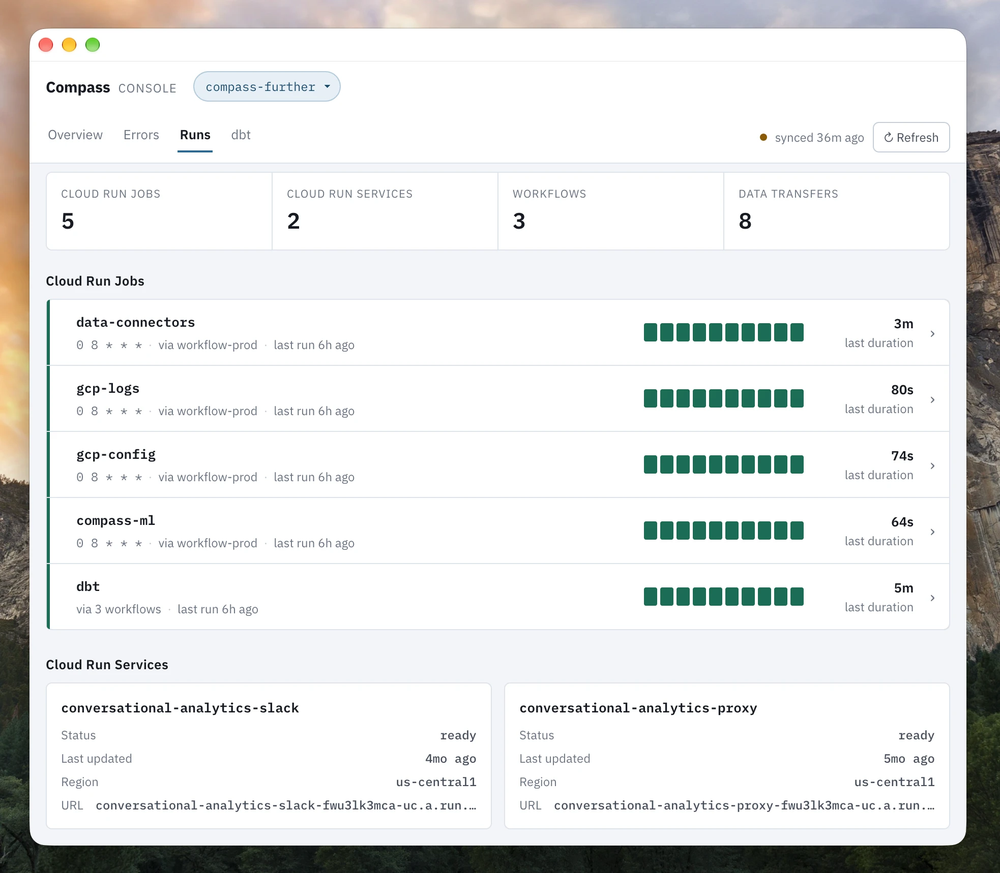

# Compass Console

A desktop app for Google Cloud Platform projects, for macOS and Windows. It answers three
questions: **is anything on fire**, **what exactly is this error**, and **did
my pipelines run**.

It runs on your own computer and reads Google Cloud with your own credentials. It
only reads your project data and it is not used anywhere except the app.

This repository holds the app's releases.



## Download

- **macOS:** [CompassConsole.dmg](https://github.com/further-external/compass-console/releases/latest/download/CompassConsole.dmg) - for Macs with Apple Silicon
- **Windows:** [CompassConsole-Setup.exe](https://github.com/further-external/compass-console/releases/latest/download/CompassConsole-Setup.exe) - for 64-bit Windows 10 and 11.
  The installer is not signed yet, so Windows shows "Windows protected your PC" -
  click **More info**, then **Run anyway**.

## Requirements

- macOS on Apple Silicon, or 64-bit Windows 10 or 11
- The [Google Cloud CLI](https://cloud.google.com/sdk/docs/install), signed in
  with `gcloud auth application-default login` - the app can run this for you
  on first launch

## IAM roles

The app reads only what your own account can. The table shows which APIs the app is reading and which IAM roles are required. 

| Role                                                                  | GCP API                                                            |
| --------------------------------------------------------------------- | ------------------------------------------------------------------ |
| `roles/errorreporting.viewer`                                         | Error Reporting API - `clouderrorreporting.googleapis.com`         |
| `roles/logging.viewer`                                                | Cloud Logging API - `logging.googleapis.com`                       |
| `roles/logging.privateLogViewer`                                      | Cloud Logging API - Data Access audit logs                         |
| `roles/run.viewer`                                                    | Cloud Run Admin API - `run.googleapis.com`                         |
| `roles/workflows.viewer`                                              | Workflows API - `workflows.googleapis.com`                         |
| `roles/bigquery.user`                                                 | BigQuery Data Transfer API - `bigquerydatatransfer.googleapis.com` |
| `roles/cloudscheduler.viewer`                                         | Cloud Scheduler API - `cloudscheduler.googleapis.com`              |
| `roles/storage.objectViewer` on the `gs://<project_id>-dbt` bucket | Cloud Storage API - `storage.googleapis.com`                  |
| `roles/aiplatform.user`, with the Vertex AI API enabled               | Vertex AI API (Gemini) - `aiplatform.googleapis.com`               |
| `roles/serviceusage.serviceUsageConsumer`                             | Service Usage - uses the API limits of the project it reads        |

**Run** button, which starts a job or workflow:

| Role                      | Starts                                                      |
| ------------------------- | ----------------------------------------------------------- |
| `roles/run.invoker`       | Cloud Run jobs                                              |
| `roles/workflows.invoker` | Workflows                                                   |

## Grant Access

`grant-access.sh` enables the APIs the app reads and grants one person all the 
roles required in one project. Run it as a project Owner, with the project ID and
the person's email:

```bash
curl -fsSL https://raw.githubusercontent.com/further-external/compass-console/main/grant-access.sh | bash -s -- PROJECT_ID EMAIL
```

The email is optional: with only `PROJECT_ID`, it enables the APIs and grants
nothing. It asks before changing anything.
